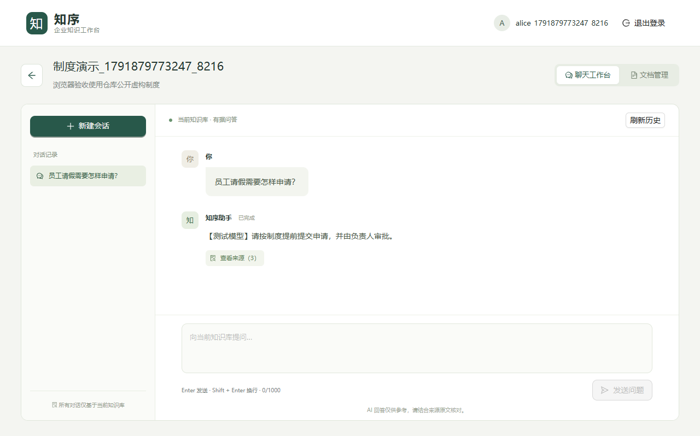
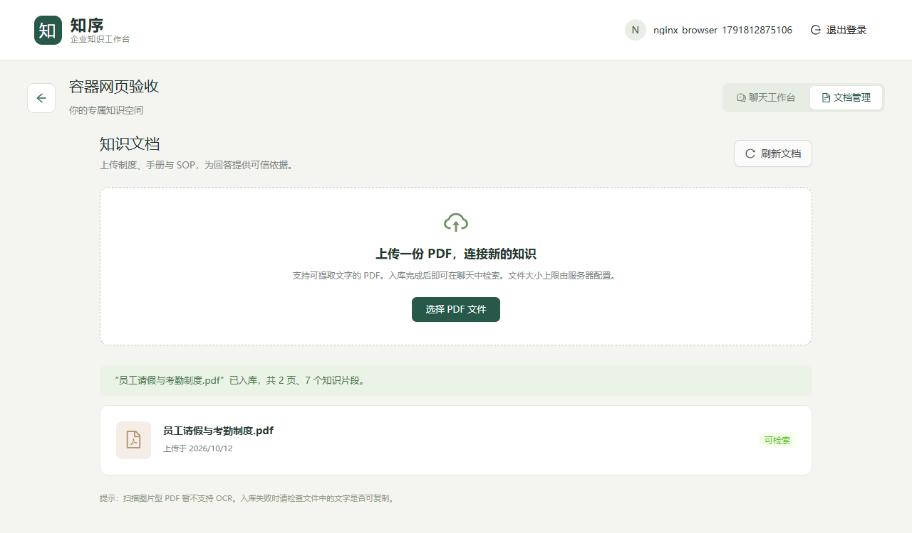
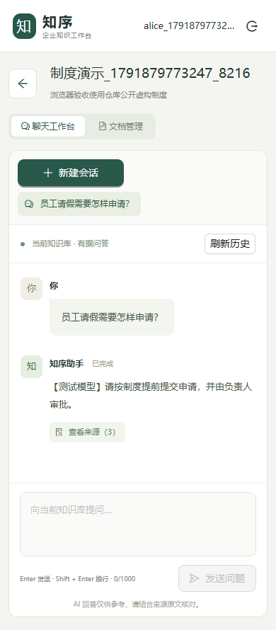
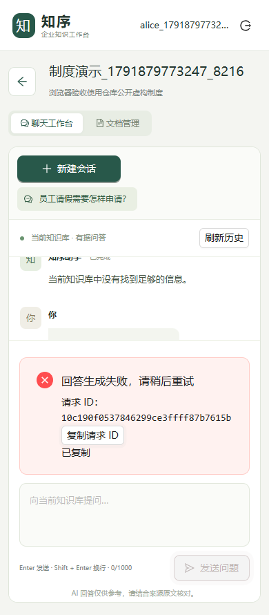
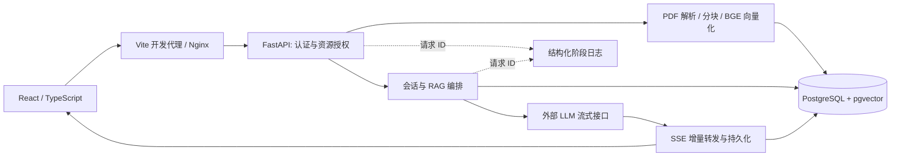

# Enterprise RAG Platform｜企业知识库 AI 问答平台

面向企业制度与 SOP 的全栈 AI 应用。用户可创建私有知识库、上传 PDF，通过流式问答查询制度，并查看回答对应的文件、页码和原文片段。

基于 **React + TypeScript、FastAPI、PostgreSQL + pgvector、BGE 中文向量模型**，实现用户资源隔离、会话与来源持久化、生成中断恢复及请求追踪。已完成真实 BGE + DeepSeek 问答链路与腾讯云私有演示部署验收，定位为求职作品和小规模试用项目。

[产品演示](#产品演示) · [工程亮点](#工程亮点与技术取舍) · [系统架构](#系统架构) · [测试与评测](#测试与评测) · [快速启动](#快速启动) · [详细文档](#详细文档)

## 产品演示

**使用流程：** 注册 / 登录 → 创建知识库 → 上传 PDF → 新建会话 → 流式阅读回答 → 核对原文来源 → 刷新恢复历史。

### 聊天工作台



桌面与移动端聊天截图来自真实浏览器端到端测试，回答中的“【测试模型】”为测试替身标识，用于验证交互、流协议和持久化。真实 BGE + DeepSeek 的回答与来源核对见 [真实模型验收记录](docs/真实模型验收记录.md)。

### PDF 入库与文档状态



截图使用仓库公开的虚构请假制度 PDF：解析为 2 页、7 个知识片段；成功入库后可在当前知识库内检索。

<details>
<summary>查看移动端与故障定位界面</summary>

移动端保留会话、提问、停止生成和来源入口。模型异常时显示可复制的请求 ID，用于关联后端日志。以下错误为测试主动注入的上游超时。




</details>

**演示方式：** 可按下方步骤在本地运行，使用 [虚构制度 PDF](data/demo_policies/pdfs/员工请假与考勤制度.pdf) 体验完整流程。云端采用 SSH 隧道私有访问，可用于面试现场演示；访问方式与已验证范围见 [云端部署验收](docs/云端部署验收记录.md)。

## 核心功能

| 能力 | 当前实现 |
| --- | --- |
| 用户认证与资源隔离 | 注册、登录、退出；每次业务访问按用户归属校验知识库、文档和会话，越权返回 404 |
| PDF 知识入库 | 多份文本型 PDF 按页解析、分块、向量化；显示处理状态，失败保留 failed 状态并回滚不完整 Chunk |
| 检索增强问答 | 在当前知识库的 ready 文档内检索，低于阈值的证据过滤；无足够证据时拒答 |
| 流式与多轮会话 | 真实上游模型增量转发、有限历史上下文、停止生成、失败和中断状态保存 |
| 回答来源核对 | 展示文档名、页码、Chunk 原文及分数；回答与来源快照持久化，刷新后可读取 |
| 请求追踪 | 上传 / 问答错误展示请求 ID，结构化日志记录解析、检索、生成与终态落库阶段 |

## 工程亮点与技术取舍

| 工程问题 | 实现方式与取舍 | 代码入口 |
| --- | --- | --- |
| 如何保护私有资源？ | PBKDF2 密码哈希、不透明 HttpOnly cookie 会话、数据库只保存令牌摘要；认证后继续检查资源 owner，支持退出撤销会话 | [认证与授权](app/auth.py)、[业务 API](app/api.py) |
| 如何避免流式回答假完成或状态被覆盖？ | 分段保存内容，区分 generating / completed / failed / interrupted；条件 UPDATE 防止迟到写入覆盖终态，部分唯一索引约束同会话的生成任务 | [会话编排](app/conversations.py)、[数据约束](app/orm_models.py)、[并发回归](tests/test_conversation_concurrency.py) |
| 如何处理中文分片、取消和切换会话？ | fetch + ReadableStream 消费 POST SSE，按 UTF-8 流与事件边界解析；取消旧请求并隔离页面上下文 | [流解析](frontend/src/sse.ts)、[聊天交互](frontend/src/Chat.tsx) |
| 为什么选 PostgreSQL + pgvector？ | 业务关系、事务和向量检索放在同一数据库，简化当前规模的一致性与部署；更大规模需依据检索和容量测试再评估 | [向量检索](app/repositories/chunk_repository.py)、[迁移](migrations/versions/) |
| 如何定位页面上的失败？ | HTTP 与 SSE 携带同一请求 ID，关联各阶段 JSON 日志；日志字段过滤原文、Prompt、回答和凭据 | [请求追踪](app/observability.py)、[追踪回归](tests/test_observability.py) |
| 如何在小内存实例部署并保留数据？ | CPU PyTorch 镜像、单 worker、受限生成并发；迁移先于 API 启动，使用持久卷，备份恢复至新数据库 | [云端编排](docker-compose.cloud.yml)、[运维脚本](scripts/cloud_deploy.py)、[部署验收](docs/云端部署验收记录.md) |

## 系统架构



- **文档入库：** 校验身份与知识库归属 → 按页解析 PDF → 字符分块 → BGE 生成 512 维归一化向量 → 事务保存文档、Chunk 和页码 → ready。
- **问答生成：** 校验会话归属 → 保存问题与 generating 消息 → 当前知识库 Top-3 向量检索 → 阈值过滤 → 将证据和有限历史交给 LLM → SSE 转发并保存文本、来源和终态。

Embedding 使用 `BAAI/bge-small-zh-v1.5`，当前默认检索阈值为 `0.55`，可通过 `RAG_MIN_RELEVANCE_SCORE` 配置。历史用于理解追问，当前检索证据用于支持回答；无足够证据时直接拒答。

关键代码按 `frontend/src/`（页面与流客户端）、`app/`（认证与 API 编排）、`app/services/`（PDF / Embedding / 检索 / LLM）、`app/repositories/`（数据库访问）组织。两条链路的时序图与设计解释见 [运行与面试指南](docs/AI全栈第一轮-运行与面试指南.md)。

## 测试与评测

**验证基线：2026-10-13，功能提交 `5f256b4`。** 自动化回归在独立 PostgreSQL/pgvector 测试库中执行，真实模型与部署另行验收。

| 验证层次 | 结果 | 覆盖范围 / 证据 |
| --- | --- | --- |
| 后端 pytest | 64 项通过 | 路由、认证、资源隔离、事务、检索、终态并发与请求追踪；[测试代码](tests/) |
| 前端 Vitest | 27 项通过 | 页面交互、中文流分片、取消、历史恢复与请求竞态；[测试代码](frontend/src/App.test.tsx)、[流解析测试](frontend/src/sse.test.ts) |
| 浏览器 Playwright | 1 项端到端场景通过 | Edge + 真实 API / PDF / pgvector，覆盖注册、上传、问答、来源、历史、越权、失败与中断；[场景代码](frontend/e2e/app.spec.ts) |
| 生产构建 | TypeScript + Vite 构建通过 | 仍有主 JS 包体积提示，待按需拆分；[构建配置](frontend/package.json) |
| 真实模型链路 | BGE + DeepSeek 问答与来源核对通过 | [真实模型验收](docs/真实模型验收记录.md)，单题链路验收与小样本质量评测分别记录 |
| 云端私有演示 | PDF 问答、重启持久化、备份恢复通过 | 腾讯云 2 核 2GB 实例；[部署验收](docs/云端部署验收记录.md) |

自动化测试中的 Embedding / LLM 使用测试替身，验证工程链路；真实模型验收验证实际推理连接和来源匹配。仓库提供 [GitHub Actions 工作流](.github/workflows/ci.yml)，对应提交的云端执行状态见 [Actions](https://github.com/lv-xiaoke/enterprise-rag-platform/actions)。

**检索评测：** 已提交的历史基线包含 4 份虚构制度 PDF、18 道题（12 道可回答题、6 道无答案题）。Top-3 在可回答题上的平均证据 Recall@3 为 **97.22%**、MRR@3 为 **95.83%**；报告保留跨文档证据不全和误拒答案例。指标只描述冻结语料下的检索表现，详见 [评测定义、失败案例与复现](docs/evaluation-report.md)。实验推荐阈值 `0.65`，当前应用默认仍为 `0.55`；这些指标不表示最终答案准确率或服务 SLA。

## 快速启动

推荐使用 Docker Compose。需 Docker Desktop / Docker Engine + Compose，首次构建及模型下载需要网络。以下命令在项目根目录使用 PowerShell 执行。

### 1. 准备配置

```powershell
if (-not (Test-Path -LiteralPath .env)) {
    Copy-Item -LiteralPath .env.example -Destination .env
}
```

在 `.env` 中修改数据库密码，并填写以下后端模型配置：

| 配置 | 用途 |
| --- | --- |
| `LLM_API_KEY` | 模型服务密钥，仅保存在后端本地环境 |
| `LLM_BASE_URL` | 兼容 OpenAI Chat Completions 流协议的服务地址 |
| `LLM_MODEL` | 实际可用的模型名称 |
| `APP_ORIGIN` | 浏览器实际地址，默认 `http://localhost:8080` |

三项 `LLM_*` 留空时仍可检查健康状态、管理知识库和执行 PDF 入库；生成式问答需要完整有效配置。调用外部模型会发送检索原文和有限历史，演示请使用仓库虚构资料。

### 2. 启动服务

```powershell
docker compose config --quiet
docker compose up --build -d
docker compose ps --all
```

启动顺序为 PostgreSQL healthy → Alembic 迁移成功 → API healthy → Web。首次 Embedding 使用会加载或下载模型，缓存由命名 Volume 保存。

- **网页：** [http://localhost:8080](http://localhost:8080)，首次访问自行注册。
- **API 文档：** [http://127.0.0.1:8000/docs](http://127.0.0.1:8000/docs)。
- **健康检查：** [http://127.0.0.1:8000/health](http://127.0.0.1:8000/health)。

本地 HTTP 保持 `AUTH_COOKIE_SECURE=false`。调整 Web 端口时同步修改 `APP_ORIGIN`。停止服务使用 `docker compose stop`，数据由 PostgreSQL 命名 Volume 保留。

### 3. 体验问答

创建知识库，上传 [员工请假与考勤制度.pdf](data/demo_policies/pdfs/员工请假与考勤制度.pdf)，新建会话并提问“员工请假应提前多久申请，需要谁审批？”。展开来源核对页码与原文，刷新确认历史，再体验停止生成和第二账号资源隔离。

宿主机开发、自动检查及旧数据迁移见 [本地开发与测试](docs/local-development.md)；镜像网络、模型配置和日志定位见 [排障指南](docs/troubleshooting.md)；云端部署与恢复见 [部署说明](deploy/README.md)。

## 已知限制与后续方向

| 当前边界 | 后续方向 |
| --- | --- |
| 支持带文字层的 PDF，暂不支持 OCR、扫描件和复杂表格 | 增加 OCR / 版面解析，并补充对应质量评测 |
| PDF 同步入库，当前 API 单 worker；启动时将遗留 generating 标为 interrupted | 后台入库队列、带租约的多 worker 恢复、生成内容批量持久化 |
| 多轮历史采用有限字符预算；检索评测样本较小 | 扩大代表性问题集，评估 token 预算、混合检索与 reranker |
| 已完成单人私有演示，尚无多人负载与生产容量结论 | 压力测试、速率限制、指标监控和前端按需加载 |
| 当前为个人私有知识库，无账号找回、企业 SSO 或共享角色 | 按业务需求扩展身份管理与团队权限 |

## 详细文档

- [运行与面试指南](docs/AI全栈第一轮-运行与面试指南.md)：五分钟演示、调用链、数据关系和技术取舍。
- [本地开发与测试](docs/local-development.md)：宿主机启动、回归命令和旧知识库归属分配。
- [排障与请求追踪](docs/troubleshooting.md)：镜像网络、模型配置、请求 ID 和阶段日志。
- [检索评测报告](docs/evaluation-report.md)：数据集、指标口径、参数实验和失败案例。
- [真实模型验收记录](docs/真实模型验收记录.md)：BGE + DeepSeek 的回答、来源和容器网页验证。
- [云端部署验收记录](docs/云端部署验收记录.md) / [部署说明](deploy/README.md)：SSH 私有演示、持久化与备份恢复。
- [升级计划与验收历史](docs/AI全栈第一轮升级计划.md) / [请求追踪实施记录](docs/superpowers/plans/2026-10-13-request-tracing.md)：实现演进与验证过程。
