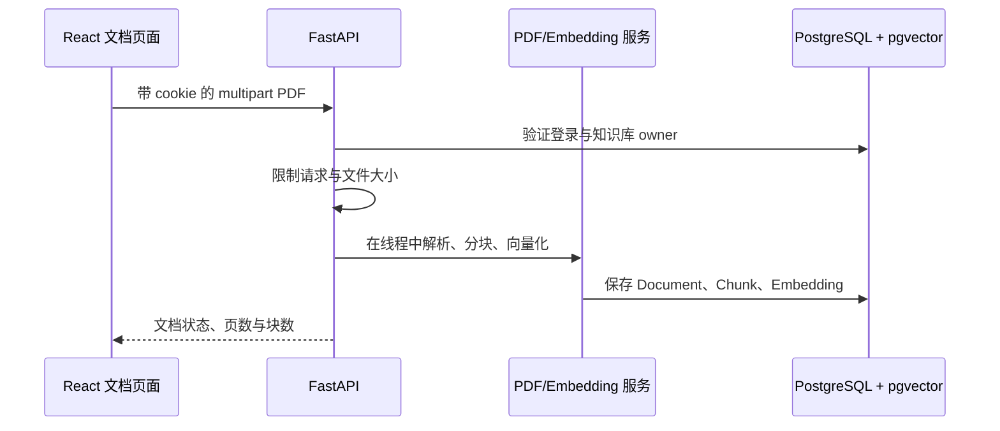
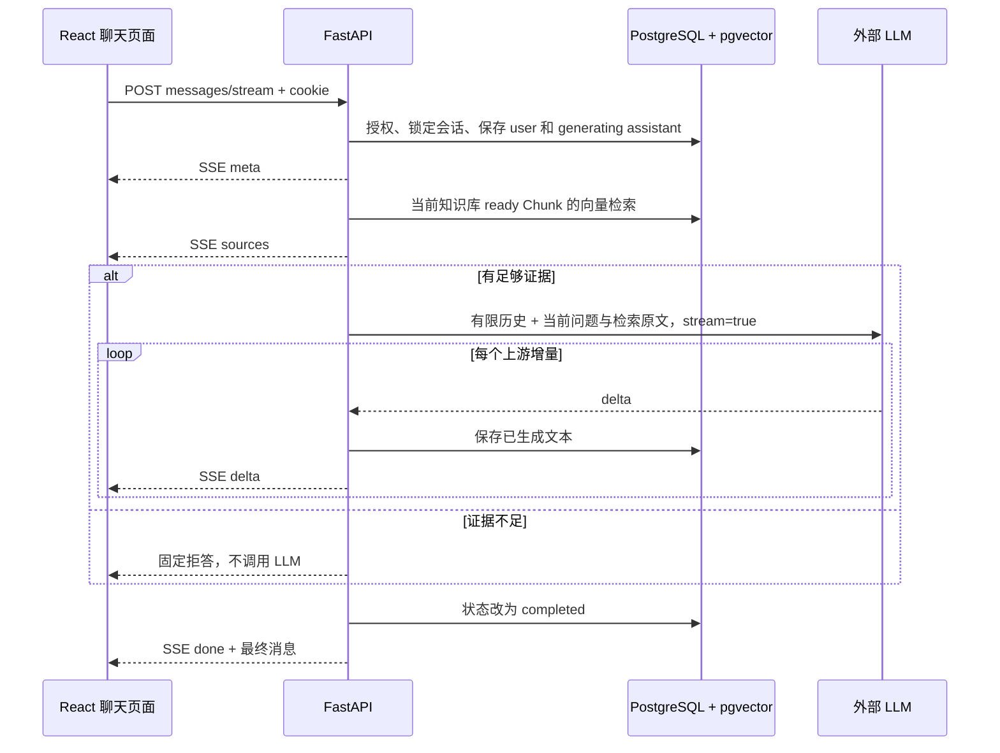

# AI 全栈第一轮：运行与面试指南

> 日期：2026-10-12。配套 [升级计划与验收记录](AI全栈第一轮升级计划.md) 和 [README](../README.md)。先跑通，再沿调用链读代码，最后独立修改一个小需求。可以说明使用 Agent 辅助开发，但项目经历中只写自己能解释和验证的内容。

## 1. 现在可以展示什么

这是一个面向企业制度和 SOP 的私有知识库 Web 应用。用户注册登录，创建自己的知识库，上传文字型 PDF，围绕当前知识库连续提问，查看流式回答与原文来源，刷新后保留消息。用户 B 修改 URL 也无法访问用户 A 的数据。停止生成会保存已生成文字和中断状态。

第一轮的价值是把已有 RAG 检索后端接成可以使用的产品闭环。后续再做任务队列、检索优化和 Agent 工具调用。当前不能描述为已经具备 OCR、企业 SSO、分布式高可用或大规模线上用户。

## 2. 先运行，再演示

详细命令见 README。开发环境顺序：独立 PostgreSQL/pgvector → 配置后端 `.env` → `alembic upgrade head` → Uvicorn → `frontend` 中 `npm ci`、`npm run dev`。

- 开发网页：`http://localhost:5173`；API：`http://127.0.0.1:8000`。
- Compose 网页：`http://localhost:8080`；Nginx 将同源 `/api` 代理给 API。
- 注册自己的账号，旧知识库默认没有 owner，不会自动出现在任何新账号下。
- 示例文件：`data/demo_policies/pdfs/员工请假与考勤制度.pdf`，内容是公开展示用的虚构制度。
- 真实模型需要后端的 `LLM_API_KEY`、`LLM_BASE_URL`、`LLM_MODEL`；前端没有模型凭据。对外模型调用会发送检索片段与有限历史，应使用允许发送的数据。

建议的五分钟演示：

1. 注册账号，创建“企业制度演示”知识库，上传示例 PDF，观察 ready 状态。
2. 新建会话，问“员工请假应提前多久申请，需要谁审批？”；显示增量文本，再展开来源核对页码和原文。
3. 追问“那紧急情况怎么办？”；说明系统会为明确指代的追问补充上一轮问题帮助检索，生成端还会获得有限历史。
4. 刷新网页，说明消息内容、状态和来源都来自数据库。
5. 换第二个账号访问第一个账号的知识库 ID，演示 404；展示停止生成与失败恢复。

真实模型是否拒答依赖真实向量分数和阈值，不应为演示预先保证某一句题目一定拒答。自动化 E2E 使用明确标注的测试模型保证可重复，不能把它的答案作为真实模型效果。

## 3. 两条必须讲清楚的代码路径

### 上传 PDF



阅读顺序：`frontend/src/Documents.tsx` → `app/api.py::upload_document` / `ingest` → `app/services/document_ingestion_service.py` → `pdf_service.py` / `embedding_service.py` → Repository / ORM。

PDF 文字按页解析，Chunk 保留页码与顺序，向量为归一化 512 维 BGE 中文表示。成功文档才可检索；失败会保留 failed 状态并回滚不完整 Chunk。上传当前是同步入库，界面显示处理中，后端将 CPU/同步 SQL 工作移入线程，线程边界并没有把它变成后台队列。

### 提问并流式回答



阅读顺序：`frontend/src/Chat.tsx` → `frontend/src/sse.ts` → `app/conversations.py::stream_message` → `app/api.py::retrieve_sources` → `app/services/retrieval_service.py` → `app/services/llm_service.py::stream_chat`。

不要把 POST 的流写成 EventSource：本项目需要携带问题 JSON 和取消控制，所以用 fetch 的 ReadableStream。一次网络 read 可能只有半个中文字符、半条 SSE，也可能包含多条事件；前端按 UTF-8 流解码和空行边界解析，后端则解析上游真实流并立即转发。测试证明消费者在上游结束前就能收到第一个增量。

## 4. 数据关系与权限

```text
User ── AuthSession（token 摘要、到期时间）
  └── KnowledgeBase.owner_id
       ├── Document ── Chunk（页码、内容、embedding）
       └── Conversation ── ConversationMessage（role/content/status/sources）
```

- 认证回答“你是谁”：PBKDF2 密码哈希验证后，浏览器得到随机 HttpOnly cookie，服务器保存令牌摘要并检查过期。退出会撤销数据库会话。
- 授权回答“这份资源是不是你的”：每次访问知识库检查 owner；会话通过所属知识库检查 owner；文档还要匹配当前知识库 ID。前端隐藏按钮不能代替后端授权。
- SameSite=Lax、Origin / Sec-Fetch-Site 检查限制浏览器跨站写请求。HTTPS 部署需要 Secure cookie 和正确 APP_ORIGIN。
- 来源保存为消息的 JSON 快照，刷新不必重新检索。它记录回答当时使用的内容，而不是当前知识库的实时投影。
- 旧数据迁移只增加可空 owner，不删除原有数据。维护脚本一次按明确 ID 分配一个未归属知识库，拒绝覆盖已有归属。

## 5. 为什么这样设计

| 面试问题 | 结合当前代码回答 |
| --- | --- |
| 为什么用 RAG？ | 制度会变化，回答要能回到原文；把事实存知识库并在提问时检索，避免每次修改都训练模型。 |
| 为什么同时保存文本和向量？ | 向量用于相似检索；原文用于 Prompt 和来源核对。向量本身不能给用户解释制度条款。 |
| 为什么用 PostgreSQL + pgvector？ | 业务关系、事务和向量检索放在一个数据库，第一阶段部署和一致性更简单；规模增长后再基于实际瓶颈评估专用检索引擎。 |
| 为什么用不透明 cookie 会话？ | HttpOnly 减少脚本直接读取令牌的机会，服务端易撤销；代价是每次认证需要数据库查询和管理会话有效期。 |
| 如何防止同一个会话同时生成两次？ | 事务内锁定 Conversation，检查 generating，并由部分唯一索引兜底；冲突返回 409。进程内信号量限制总生成数。 |
| 如何处理断流？ | 分段保存内容；停止或断连收敛为 interrupted，模型异常为 failed，完成才 completed。响应发送本身出错也执行清理，释放并发槽位。状态用数据库条件 UPDATE 保证终态不被迟到线程覆盖，仅在 Python 中先查再写不能防止该竞态。 |
| 服务重启呢？ | 单 worker 启动时把遗留 generating 改为 interrupted；多 worker 需要带租约/心跳的恢复方案，不能直接复制当前启动清理。 |
| 如何支持多轮对话？ | 仅取 completed 的完整问答对，最多读取 80 条消息，再按 12000 字符预算截取最近完整轮次；显式指代追问才给检索补前一问题。字符预算是简化方案，不是精确 token 预算。 |
| 为什么模型有历史还要重新检索？ | 历史用于理解指代，当前检索原文才是事实依据；旧回答不能替代当前证据。独立新问题不拼旧问题，避免主题污染。 |
| 为什么要有 refusal？ | 相似度低于默认 0.55 的结果过滤掉；无足够证据直接拒答。该阈值要通过代表性数据校准，不能消除所有幻觉。 |
| SSE 比 WebSocket 有什么优势？ | 这里是请求后服务端单向持续输出，HTTP 流足够；Nginx 关闭缓冲、前端可 Abort。需要持续双向实时交互时再评估 WebSocket。 |
| 如何避免切换会话后串消息？ | 会话组件按 ID 重建，请求绑定上下文并取消旧 fetch；延迟返回的旧 401 也不能清掉新账号的登录状态。 |
| 有哪些取舍？ | 同步 PDF 入库、单 API worker、每个 delta 写数据库适合当前演示规模；生产应补任务队列、限流、批量持久化、租约与监控，再测容量。 |

## 6. 测试究竟证明什么

| 层次 | 使用的真实组件 | 能证明什么 |
| --- | --- | --- |
| 后端 pytest | FastAPI 路由、认证、SQLAlchemy、已迁移 pgvector；外部模型可替换 | 权限、事务、数据状态、历史、并发、取消和流协议 |
| HTTPX 流测试 | 真正的 HTTPX 解码/迭代代码，内存 transport 上游 | 分片中文、先输出后结束、无 DONE/空流/无效 JSON/异常处理 |
| 前端 Vitest | React、交互、fetch/SSE 客户端；网络受控 | 用户流程、来源恢复、切换和账号竞态、停止与错误 |
| Playwright | Edge/Chromium、网页、API、真实 PDF 解析与 pgvector；Embedding/LLM 为测试替身 | 注册至问答完整产品闭环、刷新、跨用户隔离、拒答与停止 |
| 真实模型人工验收 | 缓存 BGE + 外部 LLM + PDF + pgvector | 真实推理连接、实际回答与来源匹配，必须单独执行并记录 |

本轮本地实际结果和限制以升级计划的“最终验收记录”为准。Docker 配置解析通过不能代替镜像构建、容器启动和容器内流式验收。GitHub Actions 文件已创建，也只有真正推送并运行后才能说 CI 通过。

用户批准后，真实 BGE + DeepSeek 的一次 PDF 问答已通过，回答和来源逐项核对见 [真实模型验收记录](真实模型验收记录.md)。这一结果补充真实推理连接验收，不替代更大样本的质量评测。

原检索评测样本是 4 份虚构 PDF、18 道题。Recall@3 评价检索召回，拒答评价阈值行为；它们都不等于真实模型最终答案准确率，也不是生产 SLA。简历必须写清样本规模与指标定义。

## 7. 故障定位顺序

- 页面登录后又退出：看 `/api/auth/me` 状态、cookie 是否保存、前后端是否同源、HTTP 环境是否误开 Secure。
- 403：检查网页实际 Origin 与 APP_ORIGIN；开发优先走 Vite 代理，不随意放开所有跨域来源。
- 404：先确认当前账号和资源归属，再检查旧数据 owner；不要直接关闭授权逻辑。
- 上传失败：看文件大小、PDF 文字层、failed 状态，再看模型缓存/下载与数据库连接。扫描件需要 OCR，改 Prompt 没用。
- 一直无来源：确认文档 ready、Chunk 已入库、知识库 ID、Embedding 模型维度、检索分数及阈值。
- sources 有、生成失败：检查后端模型配置和上游是否支持 chat/completions SSE；前端 error 不显示上游密钥或原始响应。
- 409：该会话仍在生成；先停止、等待历史恢复，或检查单 worker 的重启恢复。
- 直连 API 能逐段出字，Nginx 后一次出现：先查代理缓冲和读取超时，不给前端增加“打字动画”掩盖问题。
- Docker 拉基础镜像超时：先检查 Docker 引擎和镜像仓库网络；本地 Python/Node 测试成功不能证明 Docker 构建成功。

## 8. 最少亲手完成的练习

1. 不看文档，画出上面两条调用链，指出每个数据库写入的位置。
2. 从浏览器请求找到当前会话 ID，用第二账号验证 404，并指出实际 owner 检查函数。
3. 将 SSE 测试切成更碎的中文字节，确认消息仍完整；删除 done 事件，观察错误恢复而非假完成。
4. 在测试中让模型输出一半后抛异常，核对 failed 状态、已保存文本与来源；再测试停止生成。
5. 实现一个小需求（如会话重命名），先补越权和空标题测试，再做 API 与前端。能独立完成后，面试讲解会比背文件结构更稳。

## 9. 简历与口述示例

可在真实模型验收完成后写：

> 企业知识库 AI 应用｜React / TypeScript、FastAPI、PostgreSQL / pgvector。将 PDF 解析、向量检索和基于证据的问答接成 Web 闭环，实现 cookie 会话认证、用户资源隔离、多轮消息与来源持久化、LLM SSE 流式生成及中断恢复；通过后端、前端与浏览器集成测试覆盖权限和异常路径，提供 Docker Compose 与 CI 配置。

实际使用了 Agent 辅助时可以直接说明，并补充自己负责的需求取舍、代码理解、验证和改动。不要写“独立从零开发”，也不要虚构用户量、响应 SLA、准确率或没有完成的部署验收。
