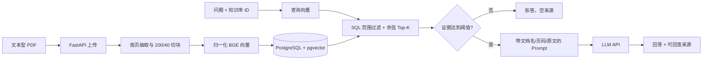

# 企业制度与 SOP RAG 项目：AI 应用开发岗位面试讲解

> 使用方式：先练习第 1 节的口述，再按第 3～5 节理解原理；被追问时用第 6 节组织回答。本文描述的是仓库当前的 PostgreSQL + pgvector 主链路。旧 SQLite 聊天与单 PDF FAISS 接口仍保留，但不是本项目介绍的重点。

## 1. 如何介绍这个项目

### 1.1 一句话版本

我独立开发了一个面向企业制度与 SOP 的多知识库 RAG 后端，把文本型 PDF 解析、切块和向量化后持久化到 PostgreSQL + pgvector，在指定知识库内检索并返回可回查的回答来源，同时用事务、状态过滤、阈值拒答和固定数据集评测保障链路质量。

### 1.2 30 秒版本

这个项目解决的是企业制度分散、直接问大模型缺少私有资料依据的问题。我用 FastAPI 提供知识库、PDF 上传和问答接口；上传时按页解析文本、按 200 字符和 40 字符重叠切块，用 BGE 中文模型生成 512 维向量，和文档名、页码、原文一起存入 PostgreSQL + pgvector。提问时只检索指定知识库中状态为 `ready` 的文档，按余弦相似度取 Top-K；没有达到当前 `0.55` 阈值的证据就直接拒答，否则调用 LLM 并返回来源。我还用 4 份虚构制度和 18 道固定问题做离线评测，区分了检索效果与最终生成效果。

### 1.3 约 3 分钟版本

**背景与目标。** 早期版本使用内存 FAISS，只能处理最近一次成功上传的单份 PDF，重启后索引消失。企业制度问答还需要按知识库管理多份文档、记录处理状态、追溯答案来源，所以我把主链路升级为 PostgreSQL + pgvector 的持久化架构。这里的核心目标是让“资料进入系统”和“依据资料回答”都可检查，而不是只演示一次模型调用。

**入库。** 用户创建知识库并上传带文字层的 PDF。`DocumentIngestionService` 先创建并提交一个 `processing` 文档记录，再让 `PDFService` 按页抽取文字，按 `chunk_size=200`、`overlap=40` 切分，调用 `BAAI/bge-small-zh-v1.5` 生成归一化的 512 维向量。Chunk 包含所属文档、页码、顺序、原文和向量。Chunk 写入与文档切为 `ready` 在同一后续事务里提交；处理失败则回滚未提交的 Chunk，并单独记录安全的 `failed` 状态。

**问答。** 问题经过同一个 Embedding 模型编码，`ChunkRepository` 在 SQL 中联结文档表，先限定知识库 ID 和 `ready` 状态，再按 pgvector 余弦距离排序并取 Top-K。服务把距离换成相似度 `score = 1 - distance`。如果没有来源达到当前阈值 `0.55`，就在调用 LLM 之前返回拒答；否则把来源的文档名、页码、Chunk ID 和原文写进 Prompt，最终响应同时返回回答与来源。相似度是检索分数，不代表回答正确的概率。

**验证与边界。** 我使用 4 份两页虚构制度和 18 道固定问题评测检索与拒答。12 道可回答题上的 Top-3 证据 Recall@3 为 `97.22%`，MRR@3 为 `95.83%`；Top-5 没有比 Top-3 增加证据覆盖。离线实验推荐阈值 `0.65`，但存在可回答题被误拒答，因此当前代码仍使用 `0.55`。项目有关键规则的 pytest 用例、Alembic 迁移和 Docker Compose 复现流程。当前只支持文本型 PDF、同步上传，尚无认证授权、ANN 索引和生产并发验证。

### 1.4 面试讲述顺序

`业务问题 → 两条数据链路 → 两个工程难点（事务状态、范围检索）→ 可核对的评测 → 限制和下一步`。被打断时，优先解释自己亲自设计的边界和实验，不必逐个念技术名词。

## 2. 项目事实卡与架构

| 维度 | 当前实现 |
| --- | --- |
| 场景 | 企业制度与 SOP 的多知识库、多文档问答 |
| API | FastAPI、Pydantic；创建/查询知识库、上传/查询文档、指定知识库问答 |
| 文档 | pypdf 解析有文字层的 PDF；按页、按字符 `200/40` 切块 |
| 向量 | `BAAI/bge-small-zh-v1.5`；查询加检索指令；文档与查询向量均归一化；维度 512 |
| 存储 | PostgreSQL 16 + pgvector；`KnowledgeBase → Document → Chunk` |
| 检索 | SQL 层知识库与 `ready` 过滤；余弦距离升序；默认 Top-3，接口允许 1～10 |
| 生成 | 达到 `0.55` 阈值后构造带来源 Prompt，再经 HTTPX 调用已配置的 LLM API |
| 工程 | SQLAlchemy + psycopg、Alembic、pytest、Docker Compose |
| 评测 | 4 份虚构 PDF；12 道可答、6 道无答案；检索与阈值实验不调用 LLM |

API 层负责请求校验、依赖注入和 HTTP 错误映射；Service 层负责入库、检索、拒答与生成的流程；Repository 层负责持久化与 SQL 查询。这个分层让“业务规则”和“数据库操作”有明确归属，面试时可以直接指向对应文件。

## 3. 主链路与相关知识

### 3.1 RAG 到底解决什么问题？

RAG（检索增强生成）在回答之前取回外部资料，把相关片段放入模型上下文。它适合经常更新、需要给出处的企业知识；无需每次修改制度就重新训练模型。它的质量取决于**解析、切块、检索、证据筛选和生成**整个链路。即使资料被检索到，LLM 仍可能理解错或忽略证据，所以“检索指标好”不等于“答案正确”。本项目流程由代码按固定顺序编排，属于 RAG workflow；没有由模型自主选择工具和循环规划的 Agent 行为。

### 3.2 为什么按页解析、切块并保留 overlap？

整份 PDF 太长，直接放进 Prompt 会占用上下文，也难以准确定位来源。项目按页抽取文字，再对每页独立按**字符数**切块：最多 200 字符，相邻块重叠 40 字符，步长为 `200 - 40 = 160`。页内切块使 `page_number` 可以回到原 PDF；重叠降低一句话落在切分边缘时的信息丢失。代价是重复文本增加存储和 Prompt 噪声。这里的 200/40 是当前小语料的基线，**不是 token 数，更不是通用最优配置**。pypdf 依赖 PDF 文字层；扫描件、图片和复杂表格未实现 OCR 或版面恢复。

### 3.3 Embedding、归一化与相似度

Embedding 把文本映射到可比较的向量空间。项目的文档和问题都使用同一个 BGE 模型；查询前加“为这个句子生成表示以用于检索相关文章：”指令，文档不加该指令。输出均做 L2 归一化，并在入库与查询时检查 512 维约定，防止模型或表结构不匹配。

对非零向量 `q`、`d`，余弦相似度为 `q·d / (||q|| ||d||)`；归一化后它等于内积。当前 pgvector 查询使用 `cosine_distance`，再计算 `score = 1 - distance`，分数越高代表在该模型空间里越接近。这个分数**不是经过校准的概率**，不能说 `0.8` 就有 80% 的答案正确率。归一化有助于向量表示的一致性；pgvector 的余弦距离运算本身并不要求事先归一化。

### 3.4 为什么用 PostgreSQL + pgvector？

早期内存 FAISS 适合快速验证向量检索，但业务元数据、文档状态和索引生命周期分散。当前方案把知识库、文档、Chunk 原文、页码及 `vector(512)` 放在同一个持久化数据模型里，便于关系联结、事务和重启恢复。它并不证明 pgvector 比 FAISS 更快；当前检索按余弦距离**精确排序**，没有 HNSW/IVFFlat 近似向量索引。

核心查询的逻辑是：`Chunk JOIN Document`，`WHERE Document.knowledge_base_id = 指定 ID AND Document.status = 'ready'`，然后 `ORDER BY cosine_distance ASC LIMIT top_k`。过滤在 SQL 中完成，避免先从全库取 Top-K 再在 Python 中剔除其他知识库的结果。这个 ID 条件只限定**查询数据范围**；接口没有用户身份和权限校验，不能称为租户隔离或访问控制。表上的常规索引也不能说成 ANN 向量索引。

### 3.5 数据模型、状态与事务

`KnowledgeBase` 一对多 `Document`，`Document` 一对多 `Chunk`。`Document.status` 允许 `pending / processing / ready / failed`；当前上传流程直接创建 `processing`，`pending` 是模型允许值，不是这条流程必经状态。数据库约束还包括知识库名称唯一、文档状态合法、同文档 Chunk 顺序唯一、页码为正、外键级联等。

上传时先提交 `processing` 记录，得到可查询的稳定文档 ID；随后解析、切块和 Embedding，最后把 Chunk 写入和切换 `ready` 放到同一个事务提交。如果后半段失败，就回滚这次尚未提交的 Chunk 与 `ready` 更新，再单独提交 `failed` 和安全错误原因。检索 SQL 只认 `ready`，因此失败或处理中数据不会进入回答上下文。这是**两次顺序数据库提交及失败补偿**，不是分布式事务协议“two-phase commit”。若失败状态本身也无法保存，服务会报处理错误；不能声称所有故障下都一定留下 `failed` 记录。

`flush()` 将待写操作发给数据库以取得 ID，但仍在当前事务内；`commit()` 才使事务结果持久化；`rollback()` 撤销当前未提交工作。Repository 操作主要使用请求级 Session，事务的提交和回滚由业务流程控制。

### 3.6 阈值拒答、Prompt 与来源

向量检索面对无答案问题也会返回“最接近”的 Chunk，因此服务在 Top-K 结果中只保留 `score >= 0.55` 的来源。若一个都没有，返回固定拒答文本、`refused=true`、空来源，而且**不调用 LLM**。有来源时，Prompt 注入文档名、页码、Chunk ID、原文及问题，并要求资料没有答案时说明不知道；响应返回 `answer` 和来源列表。

阈值是启发式门槛，会出现误接受与误拒答；达到阈值只能表示“有较近的检索片段”，不能保证该片段足以回答，生成后的 `refused=false` 也不等于经过事实校验。返回原文和页码便于人工核对，但目前没有自动逐句引用校验，也没有专门的文档提示注入防护。

### 3.7 FastAPI、异步与错误映射

Pydantic 限制问题长度和 `top_k=1..10`，并去除问题首尾空白；FastAPI 用 `Depends(get_db_session)` 为请求提供数据库 Session。知识库创建冲突返回 409，不存在返回 404，数据库错误返回安全的 503 文本，LLM 上游异常映射为 502。

LLM 调用使用 `httpx.AsyncClient`，等待网络响应时可释放事件循环；这不代表整条请求链路都异步。当前 `async` 上传/问答路由直接调用同步的 PDF 解析、Embedding 与数据库检索，CPU 计算和同步 I/O 仍可能阻塞事件循环。上传也是在请求内同步处理，没有后台任务队列。

### 3.8 SQLAlchemy、Alembic 和 Docker Compose 各做什么？

SQLAlchemy 提供 ORM、查询构造、Session 和连接池；`psycopg` 是真正和 PostgreSQL 通信的驱动。Alembic 按版本执行迁移：先启用 `vector` 扩展，再创建业务表与约束。它比直接 `create_all()` 更适合记录和复现数据库结构变化。

Compose 按 `postgres` 健康 → `migrate` 执行 `alembic upgrade head` 成功 → `api` 启动的顺序运行。`postgres_data` 保存数据库，`huggingface_cache` 保存模型缓存。LLM 的 Key、URL 和模型从本地环境变量提供；知识库 CRUD 和健康检查可以在未配置 LLM 时运行，真正调用生成式问答则需要完整配置。

## 4. 评测结果应该怎样解释

### 4.1 数据与指标

评测使用 4 份各两页的**虚构**制度 PDF、12 道可回答题和 6 道无答案题。可回答题通过预期文件名、页码和原文锚点定义证据，不依赖动态 Chunk ID。脚本复用实际检索链路，但**不调用 LLM**。

- **Recall@K**：每题在前 K 条中找回的预期证据数 ÷ 该题预期证据总数，再对 12 道可回答题取平均。跨文档题可能需要多条证据。
- **MRR@K**：每题第一条正确证据排名的倒数，没有命中记 0，再对可回答题取平均。它重视“第一条正确证据排得多靠前”。
- **完整证据题占比**：所有预期证据都进入前 K 条的题数 ÷ 12。
- **平衡拒答准确率**：`(可回答题接受率 + 无答案题拒答率) / 2`。它同时关注误拒答和漏拒答。

| Top-K | Recall@K | MRR@K | 完整证据题占比 |
| ---: | ---: | ---: | ---: |
| 1 | 61.67% | 91.67% | 41.67% |
| 3 | 97.22% | 95.83% | 91.67% |
| 5 | 97.22% | 95.83% | 91.67% |

Top-1 的 MRR 很高，说明第一条证据常能排在前面；但它不足以覆盖需要多条依据的综合题。Top-5 在当前语料上没有比 Top-3 增加证据覆盖，所以默认 Top-3 是有数据依据的选择。这**不是**最终答案准确率 97.22%。

### 4.2 阈值、失败案例与延迟

离线比较 `Top-K={1,3,5}` 和阈值 `{0.45,0.55,0.65}` 后，固定规则推荐 `Top-K=3、threshold=0.65`：该组合的平衡拒答准确率为 `95.83%`，总体拒答正确率为 `94.44%`。但 `direct-hotel-01` 是可回答题，最高来源分数仅 `0.638058`，在 `0.65` 下被**错误拒答**。因此报告的 `0.65` 只是离线建议；服务代码的实际阈值仍为 `0.55`。另一个失败案例 `cross-trip-01` 只找回跨文档题预期证据的 `2/3`，说明“有一条相关来源”不等于“证据足够完整”。

延迟数据来自两次重复的 36 个预热样本：Query Embedding + pgvector Top-K 查询的均值约 `12.80 ms`、P95 约 `15.25 ms`。它不含模型首次加载、HTTP、Prompt 和 LLM 生成，也没有大规模数据或并发压力，**不能**表述为接口 P95 或生产 SLA。

### 4.3 三种验证回答不同问题

| 方式 | 验证什么 | 当前证据 |
| --- | --- | --- |
| pytest | 输入边界、来源映射、阈值前拒答、知识库/状态过滤和排序 | `tests/` 中 7 个展开后的 case |
| 固定离线评测 | 证据召回、首个证据排名、拒答阈值和小样本检索延迟 | `data/evaluation/enterprise_evaluation_report.json` |
| 复现/演示流程 | HTTP、真实模型、数据库迁移与持久化链路 | `README.md`、`docs/demo-script.md`；现场结果须以实际运行为准 |

## 5. 高频追问与回答要点

**Q1：为什么选 RAG，而不是微调？** 这里主要是持续更新的制度事实和来源追溯。RAG 可以检索当前文档并回传原文页码；微调更适合改变模型行为或格式习惯，不能自然替代实时知识更新与引用核对。

**Q2：为什么从 FAISS 改为 pgvector？** 需要把多知识库、文档状态、元数据和向量放进同一持久化查询链路，利用 SQL 过滤、事务和迁移。选择依据是数据管理需求，并非未经测量的速度优势。

**Q3：Top-K 为什么是 3？** 固定问题集上 Top-3 的证据 Recall@3 为 97.22%，Top-1 为 61.67%；Top-5 没有增加覆盖。更大的 K 还会增加上下文长度和噪声，真实语料变化后需重新评测。

**Q4：为什么 200/40？** 当前实现按字符做可复现的页内重叠切块，降低边界断句风险。该值只是小样本基线，未做系统性的 chunk 参数网格搜索；真实长文档应按结构、检索召回、生成质量和成本重新比较。

**Q5：如何保证不会跨知识库？** Repository 在排序与 `LIMIT` 前，就用 SQL 联结 Document 并过滤知识库 ID 与 `ready` 状态；集成测试放入另一个知识库的高分 Chunk，验证它不返回。接口未做认证，所以这不是权限保障。

**Q6：上传中途失败会留下什么？** 已提交的 `processing` 文档记录保留；后续尚未提交的 Chunk 写入被回滚，然后尝试单独更新为 `failed`。即使更新失败，检索仍只读取 `ready`，不会把它当作可用证据。

**Q7：为什么阈值放在 LLM 调用前？** 无答案问题也会有最近邻。先筛证据可以避免把明显不相关资料交给 LLM，也省去这类请求的外部调用；但阈值可能误拒答，不能当事实正确性保证。

**Q8：为什么离线推荐 0.65 却使用 0.55？** 小数据集上 0.65 提高无答案拒答率，但已经出现 `direct-hotel-01` 的误拒答。扩大验证集、确定业务误拒答成本并做回归后，才能决定是否调高实际配置。

**Q9：如何区分检索错误和生成错误？** 先看预期证据是否进入 Top-K、是否通过阈值。如果没进入，检查 PDF 解析、切块、Embedding 和排序；如果证据充分却答错，检查 Prompt、上下文组织和 LLM 输出。本仓库的固定离线评测只测前一段及拒答分类，没有给出最终答案准确率。

**Q10：相似度 0.8 代表什么？** 只代表当前向量模型和余弦计算下，问题与片段相对接近。它不代表 80% 可信，也不保证资料完整、模型会正确引用或回答准确。

**Q11：`async def` 接口就能支持高并发吗？** 不能。异步 HTTPX 等待外部网络有益，但当前 Embedding、PDF 解析和数据库操作为同步调用，上传还在请求中完成。并发能力需要独立压测和针对阻塞点改造。

**Q12：为什么用 Alembic 而不只用 ORM 建表？** 迁移文件把扩展启用、建表、约束、索引及变更顺序固定下来，便于新环境复现和审查；ORM 定义描述当前结构，不能单独表达完整的结构演进历史。

**Q13：这个项目怎样减少幻觉？** 它通过指定范围检索、阈值拒答、限定资料的 Prompt 和来源返回，减少无证据直接生成的机会。但没有做最终答案事实核验或幻觉率对照实验，因此不能声称已经量化降低幻觉。

**Q14：如果要用于真实企业，先补什么？** 先补认证授权和文档级权限，再处理大文件异步入库、超时/文件大小限制、监控与审计。语料增大后用真实问题集评估混合检索、reranker 或 ANN，不能仅因技术热门就直接加入。

## 6. 面试表述边界

| 可以说 | 不应说成已实现或已证明 |
| --- | --- |
| 固定小语料上，Top-3 的**证据** Recall@3 为 97.22% | 最终答案准确率 97.22% |
| 当前代码阈值 0.55；离线建议 0.65 | 0.65 已在服务中上线 |
| SQL 中按知识库 ID 和 ready 状态限制数据范围 | 已有认证授权或多租户安全隔离 |
| 可处理有文字层的 PDF | 已支持扫描件 OCR、复杂表格或多模态 |
| 36 个预热检索样本 P95 约 15.25 ms | 整体 API/LLM 延迟 P95 或生产 SLA |
| Docker Compose 本地复现、数据库数据持久化 | 已生产部署、完成高并发或海量向量验证 |
| 前置拒答减少无证据调用的机会 | 已量化证明幻觉率降低 |

遇到“做得最困难的部分”这类开放问题，可以选**失败安全的入库事务**或**有口径的评测**讲完整：先说明问题，再说自己的设计、代码证据、验证方式及仍存在的限制。不要只列框架名。

## 7. 源码与报告速查

| 面试话题 | 仓库证据 |
| --- | --- |
| API 与 HTTP 错误 | [`app/main.py`](../app/main.py)、[`app/models.py`](../app/models.py) |
| PDF、切块、Embedding | [`app/services/pdf_service.py`](../app/services/pdf_service.py)、[`app/services/chunk_service.py`](../app/services/chunk_service.py)、[`app/services/embedding_service.py`](../app/services/embedding_service.py) |
| 入库状态和事务 | [`app/services/document_ingestion_service.py`](../app/services/document_ingestion_service.py) |
| 数据模型与数据库 Session | [`app/orm_models.py`](../app/orm_models.py)、[`app/db.py`](../app/db.py) |
| SQL 范围检索与分数 | [`app/repositories/chunk_repository.py`](../app/repositories/chunk_repository.py)、[`app/services/retrieval_service.py`](../app/services/retrieval_service.py) |
| 拒答、Prompt 与 LLM | [`app/services/database_rag_service.py`](../app/services/database_rag_service.py)、[`app/services/rag_service.py`](../app/services/rag_service.py)、[`app/services/llm_service.py`](../app/services/llm_service.py) |
| 迁移与部署 | [`migrations/versions/`](../migrations/versions/)、[`docker-compose.yml`](../docker-compose.yml) |
| 评测定义与原始结果 | [`scripts/run_evaluation.py`](../scripts/run_evaluation.py)、[`docs/evaluation-report.md`](evaluation-report.md)、[`data/evaluation/enterprise_evaluation_report.json`](../data/evaluation/enterprise_evaluation_report.json) |
| 项目运行与完整架构 | [`README.md`](../README.md)、[`docs/architecture.md`](architecture.md) |
